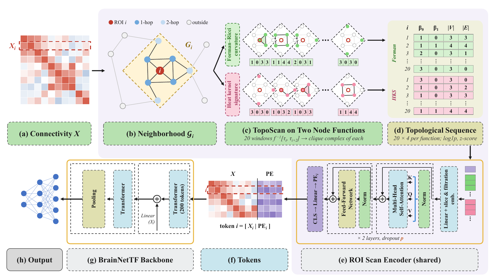

# TopoScanPE: Topological Positional Encodings for Brain Network Transformers

TopoScanPE gives each brain region a positional encoding that summarizes the topology of the network
around it, and passes that encoding to a brain network transformer alongside the region's
connectivity. The topological summary is built with Topo-Scan from
[TopoFormer](https://openreview.net/forum?id=xanpQt9YZh). All code is in `toposcanpe.py`.



## Method

1. Each connectivity matrix becomes an unweighted 8-nearest-neighbor graph, and each ROI keeps up to
   round(ρN) nearby ROIs within two hops (`knn_graph`, `two_hop`).
2. Topo-Scan slices every neighborhood along the heat kernel signature and Forman-Ricci curvature,
   and records β<sub>0</sub>, β<sub>1</sub>, the node count and the edge count of each slice
   (`scan`, `betti01`).
3. A small transformer with one set of weights for all ROIs turns each ROI's L × 8 slice sequence
   into a 16-dimensional encoding (`ROIScanEncoder`).
4. The encoding is appended to the ROI's row of the connectivity matrix, and the BrainNetTF backbone
   classifies the subject (`TopoScanPE`).

## Installation

Tested with Python 3.13.5:

```bash
pip install torch==2.8.0 numpy==2.2.6 scipy==1.16.2 pandas==2.3.2 scikit-learn==1.8.0
```

## Data

Download the preprocessed ABIDE file `abide.npy` from the link in the Dataset section of the
[BrainNetworkTransformer README](https://github.com/Wayfear/BrainNetworkTransformer#dataset). The
script reads its `corr`, `label` and `site` entries.

## Usage

```bash
python toposcanpe.py --data path/to/abide.npy
```

The defaults match the paper's ABIDE setting:

| Option        | Default   | Meaning                         |
|---------------|-----------|---------------------------------|
| `--splits`    | `5`       | Number of random splits         |
| `--epochs`    | `200`     | Training epochs per split       |
| `--node_frac` | `0.4`     | Neighborhood budget ρ           |
| `--slices`    | `20`      | Number of Topo-Scan slices L    |
| `--dropout`   | `0.1`     | Dropout in the ROI encoder      |
| `--out`       | `results` | Output folder                   |

Following BQN, each split assigns 70% of the subjects to training, 10% to validation and 20% to
test, with the same site proportions in every set. Test metrics come from the epoch with the
smallest validation loss. The script prints the mean ± standard deviation of AUC, accuracy,
sensitivity and specificity over the splits. The per-split values go to `results.csv` in the output
folder, next to the saved splits (`splits/`) and the cached Topo-Scan features (`cache/`).
